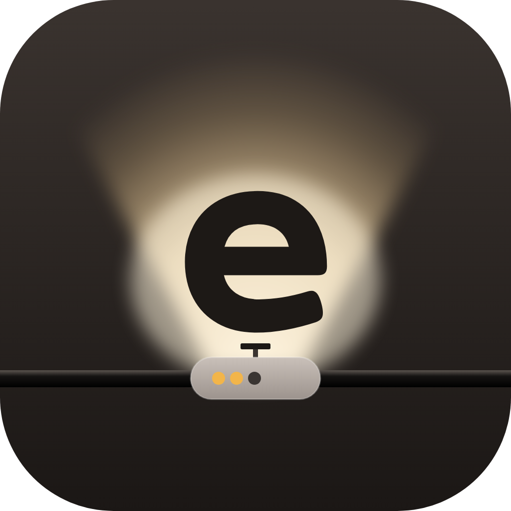

# Editor genial



**Editor genial** es un editor de texto de escritorio (Windows, macOS y Linux) hecho con Electron, con un **modo máquina de escribir**:

- La línea en la que escribes queda siempre fija sobre un **riel**; el texto sube al pulsar Enter.
- Un **carro** con un tipo en forma de "T" se desliza por el riel siguiendo al cursor.
- Una **lámpara** sale del carro e ilumina el texto con un cono de luz cálida.
- Dos **topes de margen** en el riel se arrastran para fijar los márgenes, carácter a carácter.
- Sonidos de teclas, retorno de carro y timbre de fin de línea (sintetizados, se pueden apagar).

## Editor

El texto es **enriquecido**: títulos, negritas, cursivas, subrayado, listas, **tablas** e **imágenes**,
sin perder la máquina de escribir (riel, carro, luz y hoja).

- **Formato** en **Ajustes → Formato** (negrita, cursiva, subrayado, títulos, listas, tabla, imagen).
  Dentro de una tabla aparecen ahí los controles para añadir o quitar filas y columnas, poner
  encabezado, combinar celdas o borrar la tabla. Selecciona el texto y pulsa el botón: el texto no pierde la selección.
- **Imágenes**: botón de imagen (Ctrl+Shift+I), **pegar** (Ctrl+V) o **arrastrar** al texto.
  Se redimensionan desde las esquinas.
- **Tablas**: botón de tabla (Ctrl+Alt+T); Tab pasa a la celda siguiente.
- Al pegar texto plano se conservan las líneas en blanco y las tabulaciones.

## Barra superior

- **Nombre del archivo**: haz clic para cambiarlo. Si el documento ya tiene archivo, se **renombra en el disco**
  (misma carpeta y formato; si ya existe otro con ese nombre, avisa y no toca nada). Si todavía no tiene,
  ese nombre se propone al guardar.
- **Autoguardado**: al activarlo, los cambios se guardan solos en el archivo mientras escribes
  (si el documento aún no tiene archivo, primero pregunta dónde guardarlo). La biblioteca se guarda siempre.
- Páginas y palabras, tema claro/oscuro y Ajustes.

## Papel

En **Ajustes → Papel** se elige el tema: **Clásico**, **Marfil**, **Sepia**, **Plano** (azul de plano de
arquitecto, con cuadrícula), **Pizarra**, **Fósforo** (verde de terminal antigua) y **Noche**.
El botón ☀/☾ alterna entre tu último tema claro y tu último tema oscuro. El tema solo cambia la
pantalla: los PDF y Word se guardan siempre en blanco y negro.

## Formatos

| Formato | Abrir | Guardar | Qué se conserva |
|---|:-:|:-:|---|
| Word `.docx` | ✓ | ✓ | Texto, títulos, negritas, listas, tablas, imágenes, hoja, márgenes y letra |
| Word 97-2003 `.doc` | ✓ | — | Solo el texto; se guarda como `.docx` |
| PDF `.pdf` | ✓ | ✓ | Ver abajo |
| Texto `.txt` | ✓ | ✓ | Solo texto; las tablas quedan separadas por tabulaciones |
| Markdown `.md` | ✓ | ✓ | Títulos, negritas, listas, tablas e imágenes |

### Cómo se leen los PDF

Un PDF no guarda párrafos ni tablas: solo dibuja letras, líneas e imágenes en coordenadas.
La app los reconstruye:

- **Tablas con bordes**: a partir de las líneas dibujadas (cuadrícula exacta, celdas de varias líneas y celdas combinadas en horizontal).
- **Tablas sin bordes**: por columnas alineadas en líneas consecutivas.
- **Imágenes**: se extraen con su tamaño y posición.
- **Títulos** por tamaño de letra, **negritas y cursivas** por la tipografía, y **párrafos** uniendo las líneas que se cortaron por falta de espacio.
- **Hoja y márgenes** a partir de la página.

Limitaciones: los PDF escaneados (solo imagen) no tienen texto que leer, y las maquetaciones
complejas (varias columnas de texto, tablas sin bordes ni alineación) pueden no reconstruirse
perfectamente. Al sobrescribir un Word o PDF que vino de fuera, la app avisa antes y ofrece guardar una copia.

Formas de abrir un archivo: botón **Abrir** (Ctrl+O), **arrastrarlo** a la ventana, o
**«Abrir con…» / doble clic** si la app está instalada.

## La hoja

En **Ajustes → Hoja** se define, para cada documento:

- **Formato**: Carta, A4, Oficio, Legal, A5, B5 o personalizado (ancho × alto en cm).
- **Orientación**: vertical u horizontal.
- **Márgenes** superior, inferior, izquierdo y derecho (cm).
- **Letra** (pt) e **interlineado** (sencillo, 1,15, 1,5, doble).

La app muestra los **caracteres por línea** y las **líneas por página** que resultan,
y el contador de páginas de arriba usa esa misma hoja. Lo que ves en el editor se
corresponde línea por línea con el PDF que se genera.

- **Usar como predeterminada**: la hoja actual pasa a ser la de los documentos nuevos.
- **Restablecer**: aplica la hoja predeterminada al documento actual.
- **Mostrar la hoja**: dibuja el papel y los saltos de página detrás del texto.

## Atajos

| Atajo | Acción |
|---|---|
| Ctrl+N | Nuevo documento |
| Ctrl+O | Abrir Word, PDF o texto |
| Ctrl+L | Biblioteca |
| Ctrl+S | Guardar (en el archivo vinculado, o pregunta dónde) |
| Ctrl+Shift+S | Guardar como… |
| Ctrl+P | Guardar una copia en PDF |
| Ctrl+B / Ctrl+I / Ctrl+U | Negrita / cursiva / subrayado |
| Ctrl+Shift+I | Insertar imagen |
| Ctrl+Alt+T | Insertar tabla |
| Ctrl+Shift+T | Activar/desactivar la máquina de escribir |
| Ctrl+Shift+L | Tema claro/oscuro |
| Ctrl+Shift+N | Notas de escritura |
| Ctrl+, | Ajustes |
| F11 | Pantalla completa |
| Esc | Cerrar paneles |

## Uso

Requiere [Node.js](https://nodejs.org) 22.12 o superior.

```bash
npm install
npm start
```

`npm start` compila primero el editor (`npm run build`, con esbuild) y luego abre la app.

### Crear el instalador para Windows

```bash
npm run dist:win
```

El instalador `.exe` queda en la carpeta `dist/` y asocia la app a los archivos `.docx`, `.pdf`, `.txt` y `.md`.

El ícono está en `build/` (`icon.svg` es el original; `icon.png` e `icon.ico` se generan a partir de él)
y `assets/icon.png` es el de la ventana.

## Seguridad

- Electron 45 (sin las vulnerabilidades que `npm audit` reportaba en Electron 38 y `extract-zip`).
- La interfaz corre aislada (`sandbox`, `contextIsolation`, sin Node): solo accede a las funciones del puente `preload.js`.
- No se abren ventanas nuevas ni se navega fuera de la app; solo los enlaces `http(s)` se abren en el navegador.
- Se deniegan todos los permisos (cámara, micrófono, ubicación, USB…), que la app no usa.
- La app instalada no incluye herramientas de desarrollo.
- `minimatch` se fuerza a la versión corregida solo donde electron-builder usaba una vulnerable
  (ver `overrides` en `package.json`).

## Estructura

```
assets/            ícono de la ventana
build/             ícono del instalador y de la app (.svg, .png, .ico)
main.js            proceso principal: ventana, menús, diálogos, almacenamiento
preload.js         puente seguro con la interfaz
lib/formats.js     coordina la lectura y escritura de cada formato
lib/docx-io.js     Word: lectura (mammoth) y escritura (docx)
lib/pdf-reader.js  PDF → documento: tablas, imágenes, títulos y párrafos
lib/text-io.js     texto plano y Markdown
src/editor/        editor enriquecido (Tiptap), se compila a src/vendor/
src/content.css    estilos del documento, compartidos por el editor y el PDF
src/               interfaz (HTML, CSS, lógica de la máquina de escribir y sonidos)
```

La biblioteca guarda cada documento como JSON en la carpeta de datos de la aplicación
(en Windows: `%APPDATA%\Editor genial\documentos`), con autoguardado continuo. Si tenías documentos de cuando
la app se llamaba «Máquina de escribir», se copian solos la primera vez que se abre.
